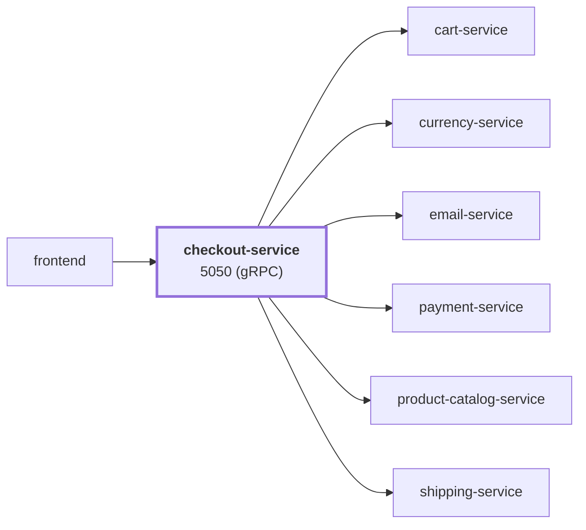

# checkout-service

service · platform-demo

A gRPC service that orchestrates order placement for the platform-demo e-commerce platform. A single `PlaceOrder` call fans out to six other services — cart, product catalog, currency, shipping, payment and email — to price the order, charge the card, ship it and confirm it. It is the most connected service in the system and holds no state of its own.

Runtime<strong>Go 1.25</strong><small>Go</small>

Listens on<strong>5050</strong><small>gRPC</small>

State<strong>Stateless</strong>

Image<strong>checkout-service</strong><small>mladenovskistefan/</small>

## Where it sits

Called by `frontend`. It calls `cart-service`, `currency-service`, `email-service`, `payment-service`, `product-catalog-service`, `shipping-service`.

## At a glance

| | |
|---|---|
| **Language / runtime** | Go 1.25 (static binary, `CGO_ENABLED=0`) |
| **Image** | `mladenovskistefan/checkout-service` |
| **Protocol / port** | gRPC (HTTP/2, plaintext) on `5050` |
| **Metrics** | Pushed over OTLP/gRPC (Prometheus registry bridged into OpenTelemetry); `/metrics` on `9090` is still served for debugging |
| **Health** | Standard `grpc.health.v1.Health/Check` on `5050` — static `SERVING`, does **not** reflect downstream health |
| **State** | None |
| **Depends on** | `product-catalog-service`, `cart-service`, `currency-service`, `shipping-service`, `payment-service`, `email-service` |
| **Called by** | `frontend` |
| **gRPC reflection** | Enabled — `grpcurl` works without `-proto` |

## Find it elsewhere

<h4><a href="https://argocd.platform-demo.test/applications/argocd/dev-checkout-service">Argo CD</a></h4>
Sync and health of <code>dev-checkout-service</code>.

<h4><a href="https://grafana.platform-demo.test/d/checkout-service-overview">Grafana</a></h4>
Latency, traffic and errors (<code>checkout-service-overview</code>).

<h4><a href="https://github.com/platform-boutique/app-checkout-service">Repository</a></h4>
Source, pull requests and releases of <code>app-checkout-service</code>.

!!! info "Part of the platform-demo platform"
    Cross-cutting facts (service wiring, observability contract, Kubernetes translation, CI/CD) are in the
    [master reference](https://github.com/platform-boutique/platform-demo-docs). This site only describes checkout-service.
